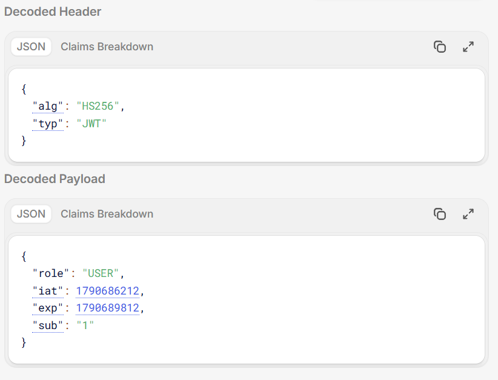

# Pesquisa — Autenticação, Autorização e JWT

**Grupo:** [nome 1], [nome 2], [nome 3] · 3º AI · ETECAMP
**Tema:** Lista de Tarefas

## A. Fundamentos

### 1. Autenticação × autorização

Autenticação é confirmar quem é a pessoa. Autorização é decidir o que essa pessoa já identificada pode fazer. Pense na portaria de um prédio: o porteiro confere seu documento (autenticação) e o seu cartão abre só a porta do seu andar (autorização).

- **Autenticação na Lista de tarefas:** o usuário digita e-mail e senha para entrar, e o sistema confere se a conta existe e se a senha está certa.
- **Autorização na Lista de tarefas:** depois de logado, cada usuário só pode editar ou apagar as tarefas que ele mesmo criou. As tarefas de outras pessoas ele não pode alterar.

**Qual status HTTP cada uma devolve quando falha?**

- **Autenticação: 401 (Não autorizado).** O servidor não sabe quem está pedindo: faltou a senha, a senha está errada ou o token expirou. Apesar do nome, o 401 trata de identificação. O cliente precisa se identificar de novo, e fazer login resolve.
- **Autorização: 403 (Proibido).** O servidor sabe quem é a pessoa e entendeu o pedido, mas recusa. As credenciais são válidas, só não dão permissão. Exemplo: o usuário João, já logado, tenta editar o status de uma tarefa da Maria. Fazer login de novo não resolve.

### 2. Stateful × stateless

**Login com sessão (stateful, como o `$_SESSION` do PHP):** é como um guarda-volumes. Você entrega o casaco e recebe uma ficha numerada (o ID da sessão, guardado num cookie). A cada visita, o servidor procura a ficha na prateleira dele. Ou seja, o servidor guarda o estado de cada usuário logado.

**Login com token (stateless):** é como um ingresso com tudo escrito e carimbado. O servidor não guarda nada sobre você, só confere se o carimbo (a assinatura) é verdadeiro.

**Sessão:**
- Vantagem: é simples e o controle é centralizado; no logout o servidor apaga o registro e o acesso termina na hora.
- Desvantagem: o servidor precisa guardar e consultar a sessão de todo mundo, o que pesa com muitos usuários e dificulta escalar para vários servidores.

**Token:**
- Vantagem: o servidor não guarda sessões, então escala com facilidade e qualquer servidor que tenha a chave consegue validar.
- Desvantagem: é difícil cancelar um token antes de vencer; se for roubado ou o usuário fizer logout, ele continua valendo até a data de expiração.

### 3. Hash × criptografia × encoding

- **Encoding:** só muda a forma de escrever o dado para ele poder ser transportado ou armazenado. Não há segredo, então qualquer pessoa desfaz. É como traduzir um texto: quem tem o dicionário traduz de volta. Exemplo: Base64.
- **Criptografia:** embaralha o dado usando uma chave, e só quem tem a chave consegue desfazer (mão dupla). É como um cofre, usado para manter o conteúdo confidencial.
- **Hash:** gera uma "impressão digital" do dado e é de mão única: não existe caminho de volta. Para conferir, calcula-se o hash de novo e compara-se com o guardado.

**Qual é usado em cada caso?** Para senhas usa-se o **hash** (com bcrypt, por exemplo). Se a senha fosse criptografada, quem roubasse a chave descobriria todas elas; com hash não há como "descriptografar". No header e no payload do JWT usa-se **encoding** (Base64URL): eles não são secretos nem criptografados, qualquer um consegue ler. Quem protege o token contra alteração é a assinatura.

### 4. bcrypt e salt

**Por que o bcrypt é mais indicado que MD5 ou SHA-256 para senhas?**
MD5 e SHA-256 foram criados para ser rápidos, e para senha a rapidez é um defeito: um computador moderno testa uma quantidade enorme de palpites por segundo. O MD5 ainda é considerado inseguro. O bcrypt foi feito para senhas: é lento de propósito, já cuida do salt sozinho e permite aumentar o esforço com o passar do tempo, conforme os computadores ficam mais rápidos.

**O que é o "custo"?**
É o número que define o quanto o bcrypt trabalha para calcular cada hash. Quanto maior, mais lento e mais seguro. Com custo 10 o algoritmo repete o processo 2^10 = 1.024 vezes, e cada ponto a mais dobra o trabalho. É preciso equilibrar: um custo alto demais deixa o login lento para o usuário. O custo 10 é um valor comum, como nos exemplos da documentação do bcryptjs.

**O que é o salt?**
É um pedaço de texto aleatório, diferente para cada senha, misturado a ela antes de calcular o hash. Assim, duas pessoas com a mesma senha ficam com hashes diferentes, e as tabelas prontas de hashes de senhas comuns (rainbow tables) deixam de servir ao invasor. O salt não é segredo: o bcrypt o guarda dentro do próprio texto do hash, junto com o custo.

## B. JWT

### 5. Estrutura

O JWT se divide em 3 partes, que são separadas por ponto. O Header, o Payload e a Assinatura, onde o Header informa o algoritmo usado e o tipo do token, o Payload é responsável por carregar as informações do usuário, no caso o role, iat, exp e sub e a Assinatura serve para garantir que ninguém altere o conteúdo sem que o token seja invalidado.



Header decodificado:

```json
{ "alg": "HS256", "typ": "JWT" }
```

Payload decodificado:

```json
{ "role": "USER", "iat": 1790686212, "exp": 1790689812, "sub": "1" }
```

### 6. Claims

**O que significam:**

- `sub` (subject): trata-se do id do usuário, que serve para que o servidor saiba quem está pedindo e se a tarefa pertence a essa pessoa. Esse id vem do token.

- `iat` (issued at): trata-se do momento em que foi criado o token, sendo colocado pela biblioteca jsonwebtoken de forma automática, quando chamamos jwt.sign. OBS: com iat e exp é possível calcular o tempo de vida do token (exp - iat).

- `exp` (expiration): define o tempo de validade do token. Ele não é escrito à mão, mas sai do expiresIn, que vem do .env (JWT_EXPIRES_IN). No nosso caso, usamos 3600 segundos, que são 1 hora. Após isso, o jwt.verify recusa o token e é necessário fazer login novamente.

**Quais claims o grupo colocou e por quê:**

```js
const token = jwt.sign({ role: user.role }, process.env.JWT_SECRET, {
  subject: String(user.id),
  expiresIn: process.env.JWT_EXPIRES_IN,
});
```

- `role`: pois o servidor precisa saber se quem pediu é o USER ou é o ADMIN, tendo o role dentro do token, o autorizar decide se libera ou não a rota sem que seja necessário buscar o usuário no banco de dados a cada requisição.

- `sub`: utilizado para saber quem é a pessoa, por meio do seu id.

- `exp`: foi criado pelo expiresIn, mencionado anteriormente, que está no arquivo .env, sendo programado como 3600 segundos, ou seja, 1 hora.

- `iat`: é adicionado automaticamente pela biblioteca.

**Payload do jwt.io:**

```json
{ "role": "USER", "iat": 1790686212, "exp": 1790689812, "sub": "1" }
```

**O que não deve ir no payload:**
Não devem ser colocados no payload nem a senha e nem dados sensíveis, visto que ele não é criptografado e qualquer pessoa pode ler.

### 7. Assinatura

Um JWT tem três partes separadas por ponto: header, payload e assinatura. Imagine um envelope com o conteúdo escrito do lado de fora e um lacre no fecho. O lacre é calculado a partir de tudo o que está escrito, usando uma chave secreta que só o servidor tem (algoritmo HMAC, por exemplo).

**Por que o usuário não consegue trocar `"USER"` por `"ADMIN"`?**
Se ele mudar o payload, o conteúdo já não combina com o lacre antigo. Quando o servidor recebe o token, refaz o cálculo, vê que o resultado é diferente da assinatura enviada e recusa o token. Para gerar uma assinatura nova e válida, o usuário precisaria da chave secreta, que ele não tem.

**Qual a diferença entre `jwt.decode()` e `jwt.verify()`?**

- `jwt.decode()`: só decodifica e mostra o conteúdo. Não usa chave nem confere a assinatura, e qualquer pessoa com o token consegue fazer isso. Ou seja, não prova que o token é verdadeiro e nunca deve ser usado para decidir quem pode entrar.
- `jwt.verify()`: lê e valida: confere a assinatura com a chave secreta e também a validade (expiração). Se algo estiver errado, dá erro e o acesso é negado. É o que se usa para proteger as rotas.

### 8. Validade e logout

**O que acontece com o token depois do logout?**
O token funciona como um ingresso de show com data de validade. O servidor não guarda uma lista dos ingressos emitidos, ele só confere se o ingresso é verdadeiro e se está no prazo. Por isso, quando você faz "logout", o site normalmente só apaga o token do seu aparelho. Se alguém tiver copiado esse token antes, ele continua funcionando até a data de validade, porque o servidor não sabe que você saiu.

**E se o perfil da pessoa mudar?**
O perfil (por exemplo USER ou ADMIN) está escrito dentro do token no momento em que ele é criado. Se o perfil mudar depois, o token antigo continua dizendo a informação antiga. Um usuário promovido a administrador continua sendo tratado como usuário comum, e um administrador rebaixado continua com poderes de administrador até o token vencer. Para receber o token atualizado, a pessoa precisa fazer login novamente.

**Formas de reduzir esse problema:**
- Dar ao token uma validade curta (como 15 minutos);
- Consultar o perfil no banco de dados a cada acesso;
- Manter uma lista de tokens cancelados.

**O que é refresh token?**
É um segundo ingresso, de longa duração, usado só para pedir um novo ingresso principal quando o antigo vence. Funciona assim: o token principal (de acesso) dura pouco, por exemplo 15 minutos. Se alguém o roubar, o estrago é limitado. Quando ele vence, o sistema usa o refresh token (que dura dias) para pedir outro automaticamente, sem pedir a senha de novo. O refresh token fica registrado no servidor, então pode ser cancelado no logout ou se for roubado. O usuário não precisa digitar a senha toda hora e a segurança continua boa.

## C. Segurança na prática

### 9. Onde guardar o token

Depois do login, o navegador precisa guardar o token em algum lugar. Há duas opções principais:

| | localStorage | Cookie HttpOnly |
|---|---|---|
| O que é | Uma "gaveta" do navegador onde o site guarda informações | Um "bilhete" que o navegador guarda e envia sozinho ao site |
| Programas da página conseguem ler? | Sim | Não (é isso que o HttpOnly significa) |
| Como o token chega ao servidor | O site precisa enviá-lo manualmente a cada pedido | O navegador envia automaticamente |
| Maior risco | XSS | CSRF |

**O que é XSS (Cross-Site Scripting)?**
É quando um atacante consegue colocar um programa malicioso dentro de uma página legítima, por exemplo por um campo de comentário que não foi bem filtrado. Esse programa roda no navegador da vítima e consegue ler o que está no localStorage, incluindo o token, e enviá-lo ao atacante. Como o cookie HttpOnly não pode ser lido por programas da página, ele protege melhor contra esse ataque.

**O que é CSRF (Cross-Site Request Forgery)?**
É quando um site malicioso engana o navegador para fazer uma ação em outro site em que você já está logado. Como o navegador envia o cookie automaticamente, o site legítimo acredita que o pedido veio de você. Um exemplo seria clicar em um link de um site falso e, sem perceber, disparar uma transferência bancária. Esse risco existe para cookies e é reduzido com atributos como SameSite e com tokens anti-CSRF.

**Resumo:** o localStorage é mais simples de usar, mas mais exposto ao XSS. O cookie HttpOnly protege melhor contra o roubo do token, mas exige cuidado extra com o CSRF.

### 10. Chave secreta

A `JWT_SECRET` é como a chave-mestra da máquina que fabrica os carimbos dos tokens. Quem tem essa chave consegue criar tokens que o sistema aceita como verdadeiros.

**Por que ela fica no arquivo `.env`?**
- Se a chave estivesse escrita direto no código, qualquer pessoa que visse o código (por exemplo, num repositório público do GitHub) a encontraria.
- O `.env` é um arquivo separado, que não é enviado ao repositório, e fica só no computador ou servidor onde o sistema roda.
- Isso permite ter chaves diferentes para testes e para o sistema real, sem mexer no código.

**O que um invasor consegue se a chave vazar?**
Ele pode fabricar tokens falsos perfeitos, com o nome de qualquer usuário e o perfil que quiser, inclusive administrador. O sistema vai aceitar esses tokens como verdadeiros, e o invasor poderá ver e alterar dados de qualquer pessoa sem precisar de senha. Apagar o arquivo depois não resolve, porque o GitHub guarda o histórico de tudo que já foi enviado. A solução é trocar a chave por uma nova, o que faz todos os tokens antigos deixarem de valer.

### 11. RBAC e dono do recurso

São duas formas diferentes de decidir o que cada pessoa pode fazer dentro de um sistema.

**RBAC (controle de acesso por perfil)**
A permissão depende do cargo da pessoa. É como num prédio de escritórios: o porteiro, o funcionário e o diretor têm cartões que abrem portas diferentes.
- Exemplo: num sistema com perfis "usuário" e "administrador", só o administrador pode ver a lista de todos os usuários ou mudar o perfil de alguém.
- Em programação, costuma-se fazer uma verificação do tipo "o perfil desta pessoa está na lista de perfis permitidos para esta ação?". Se não estiver, o sistema responde 403 (Proibido).

**Controle por dono (ownership)**
A permissão depende de o item pertencer à pessoa. É como um armário numa academia: cada um abre só o seu, mesmo que todos sejam alunos.
- Exemplo: numa lista de tarefas, você só pode editar ou apagar as tarefas que você mesmo criou. Nas tarefas dos outros, o sistema recusa.
- Em programação, o sistema compara "quem é o dono deste item" com "quem está fazendo o pedido". A identidade de quem pede deve vir do token, que é confiável, e nunca de dados enviados pelo usuário no formulário, que podem ser falsificados.

**Juntos:** muitos sistemas combinam as duas regras, por exemplo "cada usuário mexe só no que é seu, mas o administrador pode mexer em tudo".

**Onde aparece no código do nosso projeto:**
[COMPLETAR com trechos do código do grupo]
- RBAC: o middleware `autorizar("ADMIN")` nas rotas de `/users` (arquivos `src/middlewares/autorizar.js` e `src/routes/user.routes.js`).
- Dono do recurso: a função `buscarComPermissao`, em `src/controllers/tarefa.controller.js`, que compara `tarefa.userId` com o id que vem do token (`req.usuario.id`).

### 12. OWASP

A OWASP é uma organização internacional, sem fins lucrativos, que publica guias gratuitos sobre segurança de sistemas. Duas recomendações importantes dela:

**Recomendação 1: guardar senhas de forma segura (Password Storage Cheat Sheet)**
Um sistema nunca deve guardar a senha "como ela é". Deve guardar uma versão embaralhada chamada hash, que não pode ser desfeita. A OWASP recomenda usar algoritmos feitos especialmente para senhas (como Argon2id, scrypt ou bcrypt), que são propositalmente lentos e usam um salt, um tempero aleatório adicionado a cada senha. Assim, mesmo que duas pessoas tenham a mesma senha, os hashes guardados ficam diferentes, e fica muito mais difícil para um invasor descobrir as senhas caso o banco de dados vaze. Algoritmos rápidos, como MD5 e SHA-256 puro, não são indicados para senhas.

**Recomendação 2: não revelar o que errou no login (Authentication Cheat Sheet)**
Quando o login falha, o sistema deve responder com uma mensagem genérica, como "e-mail ou senha incorretos", sem dizer qual dos dois estava errado. Se a mensagem dissesse "esse e-mail não existe", um atacante poderia testar milhares de e-mails e descobrir quais têm conta no sistema, o que é chamado de enumeração de usuários.

**O nosso projeto segue essas recomendações?**
[COMPLETAR com suas palavras. Pontos para verificar no código: a senha é salva com `bcrypt.hash(password, 10)` no `register` (recomendação 1); o `login` responde "Credenciais inválidas" tanto para e-mail inexistente quanto para senha errada (recomendação 2).]

## Referências

> Preencher a data de acesso de cada link e conferir o título de cada página. O formato pedido no PDF é: *Autor/Site. Título. Disponível em: <link>. Acesso em: dd mês. 2026.*

1. JWT.IO. Introduction to JSON Web Tokens. Disponível em: <https://www.jwt.io/introduction>. Acesso em: __ out. 2026.
2. OWASP. Top Ten Project. Disponível em: <https://owasp.org/projects/top-ten>. Acesso em: __ out. 2026.
3. OWASP. Top 10:2025 (pt-BR). Disponível em: <https://top10.owasp.org/2025/pt-BR/>. Acesso em: __ out. 2026.
4. OWASP. Password Storage Cheat Sheet. Disponível em: <https://cheatsheetseries.owasp.org/cheatsheets/Password_Storage_Cheat_Sheet.html>. Acesso em: __ out. 2026.
5. OWASP. Authentication Cheat Sheet. Disponível em: <https://cheatsheetseries.owasp.org/cheatsheets/Authentication_Cheat_Sheet.html>. Acesso em: __ out. 2026.
6. FREECODECAMP. Erro 401 x erro 403 do HTTP: respostas dos códigos de status explicadas. Disponível em: <https://www.freecodecamp.org/portuguese/news/erro-401-x-erro-403-do-http-respostas-dos-codigos-de-status-explicadas>. Acesso em: __ out. 2026.
7. LOGTO. 401 vs 403. Disponível em: <https://blog.logto.io/pt-BR/401-vs-403>. Acesso em: __ out. 2026.
8. DIO. Descomplicando JWT: uma introdução clara aos tokens de autenticação. Disponível em: <https://www.dio.me/articles/descomplicando-jwt-uma-introducao-clara-aos-tokens-de-autenticacao>. Acesso em: __ out. 2026.
9. LOGTO. Autenticação baseada em token vs. autenticação baseada em sessão. Disponível em: <https://blog.logto.io/pt-PT/token-based-authentication-vs-session-based-authentication>. Acesso em: __ out. 2026.
10. LOGTO. Hashing de senha. Disponível em: <https://blog.logto.io/pt-BR/hashing-de-senha>. Acesso em: __ out. 2026.
11. TECNOBLOG. O que é hash? Entenda a função matemática que transforma dados em códigos. Disponível em: <https://tecnoblog.net/responde/o-que-e-hash-entenda-a-funcao-matematica-que-transforma-dados-em-codigos/>. Acesso em: __ out. 2026.
12. ENTRUST. Criptografia. Disponível em: <https://www.entrust.com/pt/resources/learn/encryption>. Acesso em: __ out. 2026.
13. ALURA. [COLOCAR o link completo do artigo usado; o link recebido (`https://www.alura.com.br/artigos`) é só a página geral]. Acesso em: __ out. 2026.
