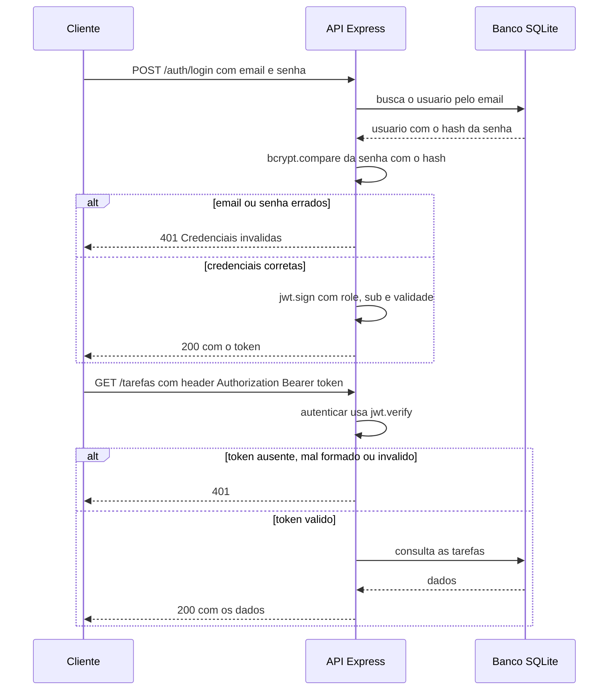

# API Tarefas — Projeto API Segura

**Grupo:** Carolina Spinella de Macedo, Emily Aparecida da Silva Menegon, Nathalia Genuino Borges · 3º AI · ETECAMP

## 1. Sobre o projeto

API REST de uma lista de tarefas desenvolvida em Node.js. Cada pessoa pode se cadastrar, fazer login e gerenciar suas próprias tarefas, informando o título e o status. O principal recurso do sistema é a **Tarefa**, que fica vinculada a um usuário. Existem dois tipos de perfil: **USER**, que pode visualizar e alterar apenas suas próprias tarefas, e **ADMIN**, que pode visualizar e alterar todas as tarefas e também gerenciar os usuários.

Tecnologias: Node.js, Express 5, Prisma 7, SQLite (driver `better-sqlite3`), `jsonwebtoken` e `bcryptjs`.

Estrutura de pastas:

```
├── docs/                    prints usados na pesquisa
├── prisma/
│   ├── migrations/
│   ├── schema.prisma        modelos User e Tarefa
│   └── seed.js              dados de exemplo
├── scripts/ver-hashes.js    mostra os hashes salvos no banco
├── src/
│   ├── controllers/         auth, tarefa e user
│   ├── lib/prisma.js        client do Prisma com driver adapter
│   ├── middlewares/         autenticar e autorizar
│   ├── routes/              auth, tarefa e user
│   └── server.js
├── .env.example
├── PESQUISA.md
├── prisma.config.ts
└── requests.http            testes T1 a T10
```

## 2. Como rodar

Requisito: Node.js 20 ou superior (testado com Node 24.19.0). O `better-sqlite3` está fixado na versão 12.9.0 no `package.json`, que traz binário pronto para o Node 24 e evita erro de compilação no Windows.

```bash
npm install
cp .env.example .env        # no cmd do Windows: copy .env.example .env
npx prisma migrate dev
npx prisma generate
npx prisma db seed
npm run dev
```

Depois de copiar o `.env`, abra o arquivo e troque o valor de `JWT_SECRET` por uma frase secreta qualquer. O servidor sobe em `http://localhost:3000`.

Variáveis do `.env`:

| Variável | Para que serve |
|---|---|
| `DATABASE_URL` | Caminho do banco SQLite (`file:./dev.db`) |
| `JWT_SECRET` | Chave secreta que assina os tokens |
| `JWT_EXPIRES_IN` | Validade do token (por exemplo `1h`) |

Usuários de teste (senha: `123456`):

| E-mail | Perfil |
|---|---|
| admin@tarefas.com | ADMIN |
| ana@tarefas.com | USER |
| bruno@tarefas.com | USER |

Para zerar o banco: `npx prisma migrate reset` e depois `npx prisma db seed` (o reset não roda o seed sozinho).

## 3. Mapa de rotas

| Método | Rota | Acesso | Proteção |
|---|---|---|---|
| GET | / | Pública | — |
| POST | /auth/register | Pública | — (nasce USER) |
| POST | /auth/login | Pública | — (devolve o token) |
| GET | /auth/me | Logado | autenticar |
| GET | /tarefas | Logado | autenticar (USER vê as suas, ADMIN vê todas) |
| POST | /tarefas | Logado | autenticar (o dono vem do token) |
| PUT | /tarefas/:id | Dono ou ADMIN | autenticar + regra do dono |
| DELETE | /tarefas/:id | Dono ou ADMIN | autenticar + regra do dono |
| GET | /users | ADMIN | autenticar + autorizar("ADMIN") |
| PATCH | /users/:id/role | ADMIN | autenticar + autorizar("ADMIN") |

## 4. Matriz de permissões

| Ação | Visitante | USER | ADMIN |
|---|---|---|---|
| Cadastrar-se e fazer login | Permitido | Permitido | Permitido |
| Ver os próprios dados (`/auth/me`) | 401 | Permitido | Permitido |
| Listar tarefas | 401 | Só as suas | Todas |
| Criar tarefa | 401 | Permitido (dono é ele) | Permitido (dono é ele) |
| Editar ou remover tarefa | 401 | Só as suas (de outros: 403) | Qualquer uma |
| Listar usuários | 401 | 403 | Permitido |
| Alterar perfil de um usuário | 401 | 403 | Permitido |

## 5. Como funciona a autenticação

Diagrama do fluxo (login → token → requisição protegida):



**Cadastro (hash da senha).** No `register`, é necessário informar nome, e-mail e senha. A senha precisa ter no mínimo 6 caracteres, caso contrário o sistema retorna erro 400. Se o e-mail já estiver cadastrado, retorna erro 409. Antes de salvar no banco, a senha é transformada em hash usando `bcrypt.hash(password, 10)`, fazendo com que ela não fique armazenada de forma legível. O usuário é cadastrado com o perfil USER, que é o padrão definido no `schema.prisma`.

**Login (token).** No `login`, o sistema procura o usuário pelo e-mail e verifica se a senha informada corresponde ao hash salvo usando `bcrypt.compare`. Caso o e-mail não exista ou a senha esteja incorreta, o sistema retorna o mesmo erro 401, com a mensagem "Credenciais inválidas", evitando informar qual dado está errado. Se os dados estiverem corretos, o sistema cria um token da seguinte forma:

```js
const token = jwt.sign({ role: user.role }, process.env.JWT_SECRET, {
  subject: String(user.id),
  expiresIn: process.env.JWT_EXPIRES_IN,
});
```

O `role` vai no payload, o id do usuário vai em `sub` e a validade vem do `.env`. A senha nunca entra no token.

**Middleware `autenticar`.** Roda antes das rotas protegidas:

```js
export function autenticar(req, res, next) {
  const authHeader = req.headers.authorization;

  if (!authHeader || !authHeader.startsWith("Bearer ")) {
    return res.status(401).json({ erro: "Token não enviado" });
  }

  const token = authHeader.split(" ")[1];

  try {
    const payload = jwt.verify(token, process.env.JWT_SECRET);
    req.usuario = { id: Number(payload.sub), role: payload.role };
    next();
  } catch (erro) {
    return res.status(401).json({ erro: "Token inválido ou expirado" });
  }
}
```

Ele devolve 401 em três casos: sem token, formato diferente de `Bearer <token>` e token inválido ou expirado. O `jwt.verify` fica dentro de um `try/catch` porque ele lança erro quando a assinatura não bate ou o token venceu, e sem o `try/catch` o servidor quebraria em vez de responder 401. Quando o token é válido, o middleware guarda `req.usuario` com o id e o perfil e chama `next()`.

## 6. Como funciona a autorização

**Por perfil (RBAC) — middleware `autorizar`.**

```js
export function autorizar(...perfis) {
  return (req, res, next) => {
    if (!perfis.includes(req.usuario.role)) {
      return res.status(403).json({ erro: "Acesso negado para o seu perfil" });
    }
    next();
  };
}
```

Ele recebe os perfis permitidos, por exemplo `autorizar("ADMIN")`, e compara com o `role` que o `autenticar` guardou em `req.usuario`. Por isso o `autorizar` sempre vem depois do `autenticar`: sem o token validado, ainda não se sabe quem é a pessoa. Se o perfil não está na lista, a resposta é 403. Ele protege as rotas de `/users`.

**Por dono — função `buscarComPermissao` (em `tarefa.controller.js`).**

```js
const tarefa = await prisma.tarefa.findUnique({ where: { id } });
if (!tarefa) {
  res.status(404).json({ erro: "Tarefa não encontrada" });   // 404 antes do 403
  return null;
}
const ehDono = tarefa.userId === req.usuario.id;
const ehAdmin = req.usuario.role === "ADMIN";
if (!ehDono && !ehAdmin) {
  res.status(403).json({ erro: "Você não pode alterar esta tarefa" });
  return null;
}
```

A tarefa é buscada no banco e o `userId` dela é comparado com o id que vem do token (`req.usuario.id`). Quem não é dono nem ADMIN recebe 403. O 404 vem antes do 403 para tarefa que não existe. Na criação (`POST /tarefas`), o dono também vem do token: se alguém mandar `userId` no body, ele é ignorado.

**Diferença entre 401 e 403 na nossa API.** O 401 acontece quando a API não sabe quem é a pessoa (sem token, token inválido, token expirado ou senha errada no login). O 403 acontece quando a pessoa foi identificada, mas o perfil ou a regra do dono não permite a ação.

## 7. Decisões do grupo


- **Payload do token:** `role` e `sub` (id do usuário), mais `iat` e `exp`, que a biblioteca coloca sozinha. Não colocamos senha nem dados sensíveis, porque o payload só é assinado, não é criptografado: [motivo do grupo].
- **Validade do token:** 1 hora (`JWT_EXPIRES_IN`): [motivo do grupo].
- **O dono vem do token:** o `userId` de uma tarefa nova nunca é lido do body, porque o body pode ser inventado por qualquer pessoa.
- **Em produção faríamos:** usar HTTPS; limitar tentativas de login (rate limit); usar refresh token com token de acesso mais curto; guardar o token em cookie HttpOnly; guardar o `JWT_SECRET` em um gerenciador de segredos; e tratar o cadastro para não revelar se um e-mail já existe (hoje responde 409).

## 8. Testes

Os testes estão no arquivo `requests.http`. Para usar: instale a extensão **REST Client** no VS Code, deixe a API rodando (`npm run dev`) e clique em **Send Request** em cada bloco, **de cima para baixo**. Os três logins (Admin, Ana e Bruno) precisam rodar antes dos blocos que usam o token deles, porque o token é reaproveitado automaticamente. O T1 só devolve 201 na primeira vez; depois o e-mail já existe e vira 409 (para repetir, mude o e-mail do T1 ou use `npx prisma migrate reset` e `npx prisma db seed`).

| # | Cenário | Esperado | Obtido |
|---|---|---|---|
| T1 | Cadastro válido (resposta sem senha) | 201 | 201 |
| T2 | Cadastro com e-mail repetido | 409 | 409 |
| T3 | Login com senha errada | 401 | 401 |
| T4 | Rota protegida sem token | 401 | 401 |
| T5 | Rota protegida com token válido | 200 | 200 |
| T6 | Criar tarefa mandando o dono no body (ignorado) | 201 | 201 |
| T7 | USER alterando tarefa de outro USER | 403 | 403 |
| T8 | USER em rota de ADMIN | 403 | 403 |
| T9 | ADMIN em rota de ADMIN | 200 | 200 |
| T10 | Recurso inexistente | 404 | 404 |

Também testamos token com formato errado (401), token adulterado (401) e perfil inválido em `PATCH /users/:id/role` (400).

## 9. Fontes e ferramentas usadas

- Pesquisa e referências: ver o arquivo `PESQUISA.md`.
- Bibliotecas: `express`, `dotenv`, `jsonwebtoken`, `bcryptjs`, `@prisma/client`, `@prisma/adapter-better-sqlite3`, `better-sqlite3`, `prisma` e `tsx`.
